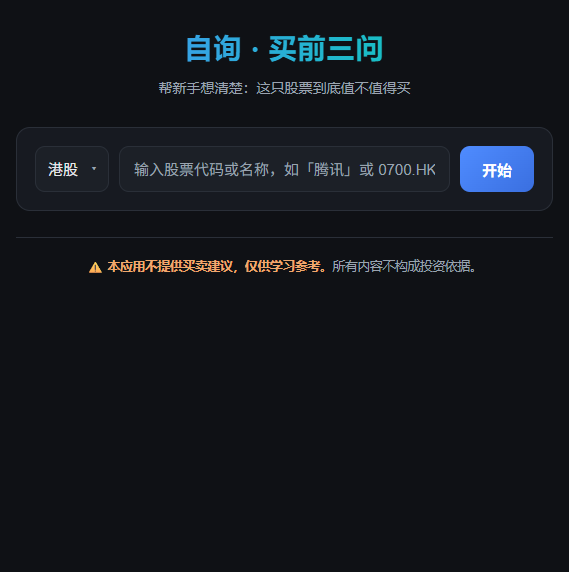
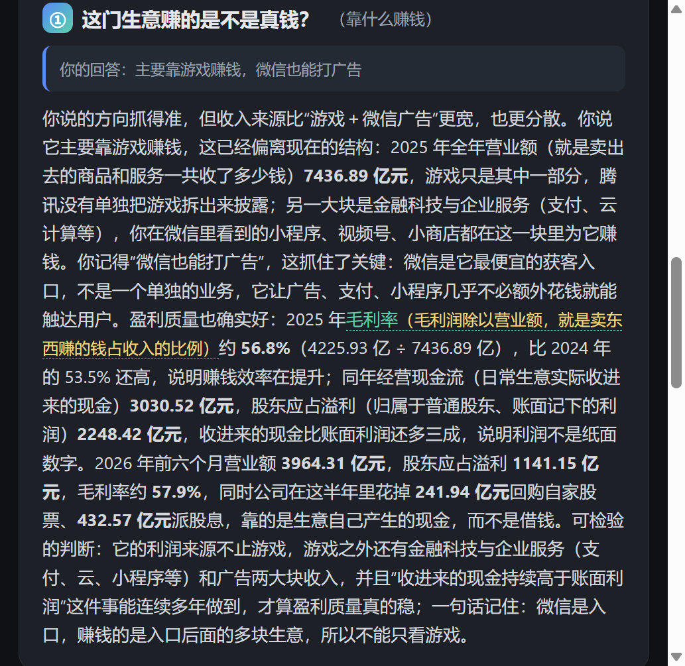

# 自询 ZiXun · 买前三问

> 市面上的 AI 做「咨询」，我们做「自询」——一个**拒绝荐股**的 AI 投资引导应用：不推荐买卖，只帮你把问题想清楚。

新手买股票最常犯的错误不是选错股，而是根本没想清楚就下了单。市面上的 AI 都在回答"买哪只"，本项目反其道而行：AI 不给你答案，而是抛给你三个固定问题，**让你先写下自己的判断**，再针对你的回答逐条纠偏、补全。

**这条原则写死在数据结构里：返回 JSON 中根本没有"建议/结论"字段——比规则更强硬。**

## 截图

| 首页 | 三问表单 | AI 回应（术语内联展开） |
|---|---|---|
|  |  |  |

## 三个问题（层层递进）

1. **这门生意赚的是不是真钱？** —— 看懂生意：营收结构、毛利率、现金流
2. **现在这个价，买贵了没有？** —— 判断价格：PE、历史区间、同行对比
3. **万一买错了，最坏亏多少？** —— 测试承受力：现金流、集中度、估值回撤

每个问题由"决策视角标题 + 引导语 + 为什么问"三层构成（前端静态写死，不由 AI 生成）。回答可留空——留空则由 AI 给出完整陈述式分析。

## AI 回应的三步骨架

每题回应固定走：**主观先行**（先接住你判断里说对的部分）→ **数据纠偏**（用财报数字指出偏差）→ **落到纸面**（提炼一句可检验的判断收尾）。每答必引具体数字，绝不说空话；技术术语以 `[术语]` 包裹并附白话解释，网页上点击即可内联展开，PDF 报告中平铺呈现。

## 三条不可妥协的底线

- **绝不输出买卖结论、目标价、投资建议**——JSON schema 不设"建议"字段
- **每答必引具体数字**——营收、PE、现金流、利润率，不说空话
- **只说平实语言**——术语必须带白话解释，默认读者零基础

免责声明三处常显：网页页脚、每张回应卡片、PDF 报告页脚。

## 技术栈

C# ASP.NET Core Minimal API ｜ 原生 HTML/CSS/JS（零框架、零外部 JS 依赖、零构建步骤）｜ QuestPDF（报告生成，Community License）｜ ARTi API（SSE 流式）

股票索引为本地 CSV 内存索引（19114 条：A股 / 港股 / 美股），支持名称、代码、拼音搜索，前缀匹配优先。

## 运行

前置：.NET 8 SDK ＋ 一个 ARTi API Key。

```bash
# Windows / macOS / Linux
set ARTI_API_KEY=你的key        # Windows cmd；PowerShell: $env:ARTI_API_KEY="..."
export ARTI_API_KEY=你的key     # macOS / Linux

cd Advisor
dotnet run
# 浏览器打开 http://localhost:5050
```

也可以在 `Advisor/` 下新建 `appsettings.Local.json`（已 gitignore）写入 `"Arti": { "ApiKey": "..." }` 代替环境变量。**Key 绝不入库。**

## API

| 端点 | 说明 |
|---|---|
| `POST /api/analyze` | `{ query, market, answers[] }` → `{ responses[{ id, response, terms[{term,plain}] }] }` |
| `GET /api/suggest?q=&market=` | 自动补全（前缀匹配优先） |
| `POST /api/export-pdf` | QuestPDF 生成报告，术语平铺 |

## 项目结构

```
Advisor/               ASP.NET Core 后端 + 静态前端
  Program.cs           Minimal API 端点
  Services/            StockResolver（CSV 索引）/ PromptBuilder / ArtiClient / PdfExporter
  Prompts/             three-questions.txt（Prompt 模板，不写死在代码里）
  wwwroot/             原生 HTML/CSS/JS
  Data/stocks.csv      股票索引（19114 条）
design.md              唯一施工蓝图（13 节设计文档）
devlog.md              开发记录（决策历史）
演示稿.md              5 分钟演示脚本
一页说明.md/.pdf       项目一页纸介绍
demo-shots/            实演截图
samples/               导出的 PDF 样例
prototype.html         交互原型
```

## 免责声明

本应用不提供买卖建议，仅供学习参考。所有内容不构成投资依据。
